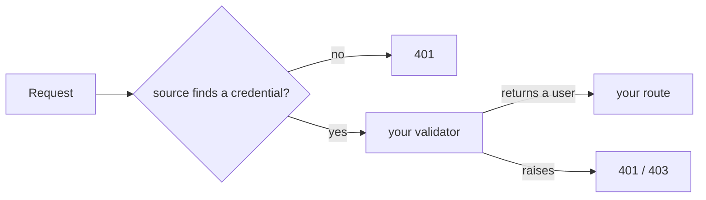

# Guide

Everything in `fastapi-multiauth` is built from one idea: a **source** knows *where* a credential lives in a request, and a **validator** you write decides *who* it belongs to.

A source is a FastAPI dependency: pass it to `Security()` and your route receives what the validator returned. It also declares itself in OpenAPI, so `/docs` shows the right **Authorize** dialog.

The library never stores anything and never looks at your user model. Deciding what a valid credential means is always your validator's job.

## The sources

| Source | Reads | Page |
| --- | --- | --- |
| [`HTTPBearerAuth`][fastapi_multiauth.HTTPBearerAuth] | `Authorization: Bearer ...` | [Bearer tokens](bearer-tokens.md) |
| [`APIKeyCookieAuth`][fastapi_multiauth.APIKeyCookieAuth] | a cookie, optionally signed | [Cookie sessions](cookie-sessions.md) |
| [`APIKeyHeaderAuth`][fastapi_multiauth.APIKeyHeaderAuth] | a named header | [API keys and Basic](api-keys-and-basic.md) |
| [`APIKeyQueryAuth`][fastapi_multiauth.APIKeyQueryAuth] | a query parameter | [API keys and Basic](api-keys-and-basic.md) |
| [`HTTPBasicAuth`][fastapi_multiauth.HTTPBasicAuth] | `Authorization: Basic ...` | [API keys and Basic](api-keys-and-basic.md) |
| `OAuth2...BearerAuth`, `OpenIdConnectAuth` | a token from your identity provider | [JWT and OAuth 2.0](jwt-and-oauth2.md) |
| [`HMACSignatureAuth`][fastapi_multiauth.HMACSignatureAuth] | a signed request body, from a webhook sender | [Signed webhooks](webhooks.md) |

Need something else? Write a [custom source](custom-sources.md).

Start with [Validators](validators.md).
