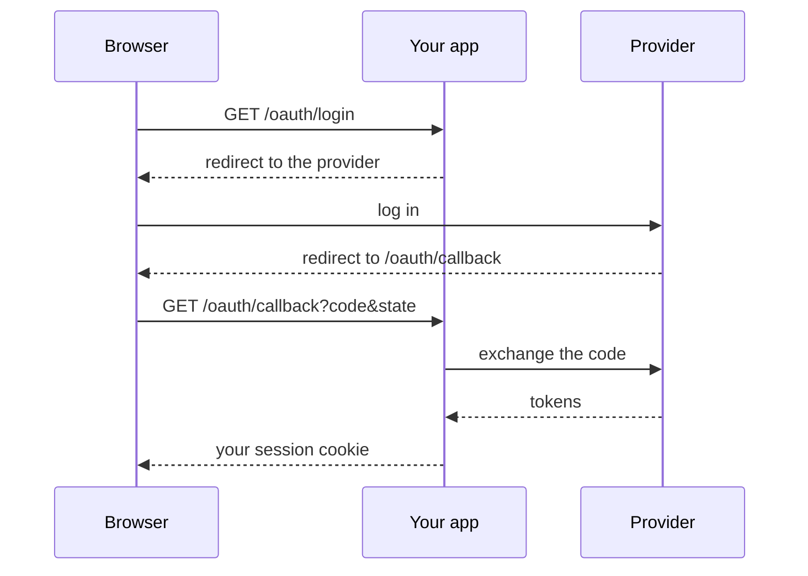

# OAuth login flow

The other pages *check* a credential. The OAuth helpers *obtain* one: they handle the tricky parts of a "Log in with..." button (discovery, CSRF protection, PKCE, code exchange, ID token validation), while you keep the routes.

```bash
uv add "fastapi-multiauth[oauth,jwt]"
```



## 1. Redirect to the provider

```python
--8<-- "docs_src/recipes/oidc_sign_in.py:login"
```

The state, nonce and PKCE verifier are kept in the server session (Starlette's `SessionMiddleware`) until the user comes back.

## 2. Handle the callback

```python
--8<-- "docs_src/recipes/oidc_sign_in.py:callback"
```

- `oauth_decode_state` refuses a callback this browser did not start, and only allows relative `next` URLs by default.
- `oauth_validate_id_token` checks the ID token's signature, issuer, audience, expiry and nonce. Never trust an ID token before that.
- Every helper raises a subclass of [`OAuthError`][fastapi_multiauth.oauth.OAuthError], so one `except` covers the whole callback.

The [OpenID Connect recipe](../recipes/oidc-sign-in.md) shows the full file.

!!! warning "The discovery URL is configuration"
    Never build it from request input.
